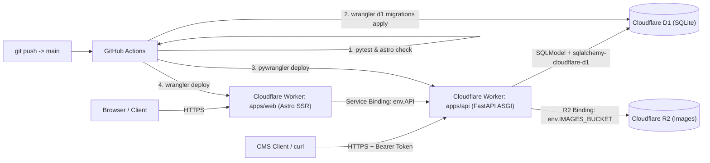

# Technical Implementation Plan: Astro + FastAPI Blog CMS Monorepo on Cloudflare

## Architecture Overview

The repository is structured as a two-app Cloudflare monorepo (`apps/web` + `apps/api`) deployed via GitHub Actions:



---

## Target Monorepo Directory Structure

```text
my-personal-website/
├── .github/
│   └── workflows/
│       └── deploy.yml                  # CI/CD: test, migrate D1, deploy api + web on push to main
├── apps/
│   ├── web/                            # Astro 5 + React + Tailwind CSS frontend Worker
│   │   ├── public/
│   │   ├── src/
│   │   │   ├── lib/
│   │   │   │   ├── api.ts              # Typed API client (Service Binding + HTTP fallback)
│   │   │   │   └── posts.ts            # Fetches blog posts from FastAPI CMS
│   │   │   ├── layouts/
│   │   │   │   └── BlogPost.astro
│   │   │   └── pages/
│   │   │       ├── index.astro
│   │   │       ├── rss.xml.js
│   │   │       └── blog/
│   │   │           ├── index.astro
│   │   │           └── [...slug].astro # SSR route + sanitized Markdown rendering
│   │   ├── astro.config.mjs
│   │   ├── package.json
│   │   ├── tsconfig.json
│   │   ├── worker-configuration.d.ts
│   │   └── wrangler.json               # Service Binding "API" -> "my-personal-website-api"
│   └── api/                            # Python FastAPI + SQLModel + Alembic Worker
│       ├── alembic/
│       │   ├── env.py
│       │   └── versions/
│       │       └── 0001_initial_schema.py
│       ├── migrations_d1/
│       │   └── 0001_initial_schema.sql # Wrangler D1 SQL migration exported from Alembic
│       ├── scripts/
│       │   ├── export_d1_migration.py  # Generates offline SQL from Alembic for D1
│       │   └── seed_posts.py           # Migrates existing 4 Markdown posts & images
│       ├── src/
│       │   ├── __init__.py
│       │   ├── main.py                 # FastAPI app + Cloudflare workers.asgi entrypoint
│       │   ├── config.py               # Settings & Worker env binding extraction
│       │   ├── auth.py                 # Bearer token dependency (API_ADMIN_TOKEN)
│       │   ├── database.py             # Dual engine: D1 binding (Workers) / SQLite (local/test)
│       │   ├── models.py               # SQLModel tables + Pydantic DTOs
│       │   ├── storage.py              # R2 binding abstraction + in-memory fake for tests
│       │   └── routers/
│       │       ├── __init__.py
│       │       ├── health.py           # GET /api/health
│       │       ├── posts.py            # CRUD /api/posts & /api/posts/{slug}
│       │       └── images.py           # POST/GET/DELETE /api/images
│       ├── tests/
│       │   ├── conftest.py
│       │   ├── test_health.py
│       │   ├── test_posts.py
│       │   ├── test_images.py
│       │   └── test_seed.py
│       ├── .dev.vars.example
│       ├── .python-version             # 3.12
│       ├── alembic.ini
│       ├── pyproject.toml              # uv + workers-py + fastapi + sqlmodel + alembic + pytest
│       └── wrangler.jsonc              # Python Worker config with D1 & R2 bindings
├── specs/
│   └── 001-fastapi-blog-cms-monorepo/
│       ├── spec.md
│       ├── plan.md
│       └── tasks/
│           ├── index.md
│           └── task-01..08.md
├── package.json                        # Root npm workspaces orchestrator
├── package-lock.json
└── .gitignore
```

---

## Database Schema (`apps/api/src/models.py`)

### Table: `image_assets` (`ImageAsset`)
| Column | Type | Constraints / Indexes | Notes |
| :--- | :--- | :--- | :--- |
| `id` | `int \| None` | Primary Key | Auto-increment |
| `object_key` | `str` | `unique=True, index=True, nullable=False` | R2 object key, e.g. `uploads/2026/11/<uuid>.webp` |
| `filename` | `str` | `nullable=False` | Sanitized original filename |
| `content_type` | `str` | `nullable=False` | Validated MIME (`image/jpeg`, `image/png`, `image/webp`, `image/avif`, `image/gif`) |
| `size_bytes` | `int` | `nullable=False` | File size in bytes (max 10 MB) |
| `alt_text` | `str` | `default=""` | Default alt text |
| `created_at` | `datetime` | `default_factory=utcnow` | UTC timestamp |

### Table: `posts` (`Post`)
| Column | Type | Constraints / Indexes | Notes |
| :--- | :--- | :--- | :--- |
| `id` | `int \| None` | Primary Key | Auto-increment |
| `slug` | `str` | `unique=True, index=True, nullable=False` | URL-safe slug |
| `title` | `str` | `nullable=False` | Post title |
| `description` | `str` | `nullable=False` | Short summary / meta description |
| `content` | `str` | `nullable=False` | Markdown body |
| `category` | `str` | `index=True, nullable=False` | Post category |
| `hero_image_key` | `str \| None` | `foreign_key="image_assets.object_key", nullable=True` | Optional link to R2 `ImageAsset` |
| `hero_image_url` | `str` | `nullable=False` | Public delivery URL (e.g. `/api/images/<key>` or custom R2 URL) |
| `image_alt` | `str` | `default=""` | Alt text for hero image |
| `published` | `bool` | `default=True, index=True` | Visibility flag |
| `pub_date` | `datetime` | `index=True, nullable=False` | Publication timestamp |
| `updated_date` | `datetime \| None` | `nullable=True` | Last updated timestamp |
| `created_at` | `datetime` | `default_factory=utcnow` | UTC record creation timestamp |

---

## REST API Contract (`apps/api`)

| Method | Path | Auth | Success Status | Error Statuses | Description |
| :--- | :--- | :--- | :--- | :--- | :--- |
| `GET` | `/api/health` | Public | `200 OK` | `503` | Verifies Worker & D1/SQLite connectivity |
| `GET` | `/api/posts` | Public (Bearer for drafts) | `200 OK` | `401` (if `include_drafts=true` without auth) | List posts sorted by `pub_date DESC` (`?category=`, `?include_drafts=`) |
| `GET` | `/api/posts/{slug}` | Public (Bearer for drafts) | `200 OK` | `404` | Retrieve post by slug |
| `POST` | `/api/posts` | Bearer Token | `201 Created` | `401`, `409`, `422` | Create a new blog post |
| `PATCH` | `/api/posts/{slug}` | Bearer Token | `200 OK` | `401`, `404`, `409`, `422` | Partially update an existing post |
| `DELETE` | `/api/posts/{slug}` | Bearer Token | `204 No Content` | `401`, `404` | Delete a post by slug |
| `POST` | `/api/images` | Bearer Token | `201 Created` | `400`, `401`, `413`, `415` | Validate MIME/size (<=10 MB), store in R2, persist `ImageAsset` |
| `GET` | `/api/images/{key:path}` | Public | `200 OK` | `404` | Stream image from R2 with `Content-Type` and immutable `Cache-Control` |
| `DELETE` | `/api/images/{key:path}` | Bearer Token | `204 No Content` | `401`, `404` | Remove image from R2 and `image_assets` |

---

## Cloudflare Runtime & Tooling Details

1. **Python 3.12 on Pyodide**:
   - Cloudflare Python Workers run CPython 3.12 compiled to WebAssembly (Pyodide).
   - `apps/api/.python-version` pins `3.12` and `apps/api/pyproject.toml` sets `requires-python = ">=3.12,<3.13"`, managed via `uv` (v0.13.7 installed locally).
   - Pure-Python packages compatible with Pyodide are required; avoid native C-extension dependencies (such as `greenlet` for SQLAlchemy async) inside the Worker runtime.
2. **Dual Database Engine (`apps/api/src/database.py`)**:
   - **In Cloudflare Workers**: extracts `env.DB` from `request.scope["env"]` and creates a SQLAlchemy engine via `sqlalchemy_cloudflare_d1.create_engine_from_binding(env.DB)`.
   - **In local `pytest` / scripts**: uses a standard SQLite engine (`sqlite:///./local.db` or `sqlite://` in-memory) controlled by `DATABASE_URL` / dependency overrides.
3. **Alembic -> Wrangler D1 Workflow**:
   - `alembic revision --autogenerate` generates Python migrations against `SQLModel.metadata`.
   - `apps/api/scripts/export_d1_migration.py` runs Alembic in `--sql` offline mode (or extracts DDL statements) into numbered SQL files under `apps/api/migrations_d1/0001_initial_schema.sql`.
   - Wrangler applies those SQL files locally (`wrangler d1 migrations apply personal-website-db --local`) and remotely in CI (`wrangler d1 migrations apply personal-website-db --remote`).
4. **Astro <-> FastAPI Service Binding**:
   - `apps/web/wrangler.json` configures `"services": [{ "binding": "API", "service": "my-personal-website-api" }]`.
   - `apps/web/src/lib/api.ts` calls `locals.runtime.env.API.fetch(new Request("https://api.internal" + path))` in Cloudflare Workers and `fetch((import.meta.env.API_URL ?? "http://127.0.0.1:8787") + path)` during local development.

---

## Testing & Verification Strategy

- **Backend Tests (`apps/api`)**:
  ```bash
  cd apps/api && uv run pytest -v
  ```
  Covers health check, posts CRUD, draft visibility, duplicate slug `409`, missing slug `404`, auth `401`, R2 image upload/retrieval/deletion, MIME/size validation, and idempotent seeding.
- **Database Migrations**:
  ```bash
  cd apps/api && uv run alembic upgrade head && npx wrangler d1 migrations apply personal-website-db --local
  ```
- **Frontend Build, Typecheck & Worker Dry-Run**:
  ```bash
  npm run check --workspace=apps/web
  ```
- **Manual End-to-End Check**:
  Run `cd apps/api && uv run pywrangler dev` and `npm run dev --workspace=apps/web`, seed the 4 existing posts with `seed_posts.py`, upload an image and create a post via `/api/images` and `/api/posts`, and verify live SSR rendering on `/` and `/blog/`.

---

## One-Time Cloudflare & GitHub Prerequisites (Manual Setup Before First Live Deploy)

1. Create Cloudflare D1 database:
   ```bash
   npx wrangler d1 create personal-website-db
   ```
   Copy the generated `database_id` into `apps/api/wrangler.jsonc`.
2. Create Cloudflare R2 bucket:
   ```bash
   npx wrangler r2 bucket create personal-website-images
   ```
3. Set the production admin secret on the API Worker:
   ```bash
   cd apps/api && npx wrangler secret put API_ADMIN_TOKEN
   ```
4. Add GitHub repository secrets for CI/CD:
   - `CLOUDFLARE_API_TOKEN` (Workers Scripts Edit, D1 Edit, Workers R2 Storage Edit)
   - `CLOUDFLARE_ACCOUNT_ID`

---

## Non-Goals

- Admin Web UI / WYSIWYG editor in `apps/web`.
- Multi-user authentication, OAuth, or RBAC.
- On-the-fly Cloudflare Image Transformations (`/cdn-cgi/image`).
- Comments, likes, or page-view analytics.
- Immediate deletion of `apps/web/src/content/blog/*.md` backup files.
